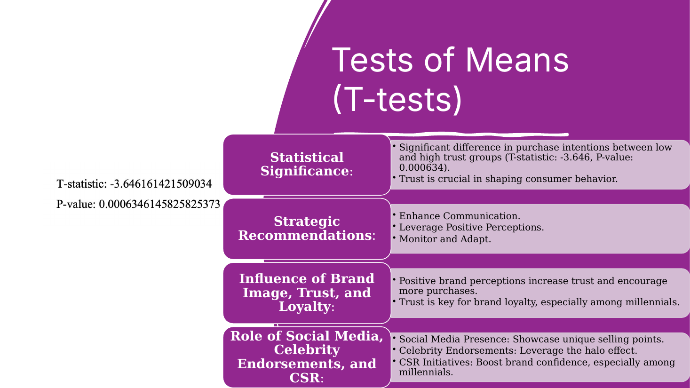
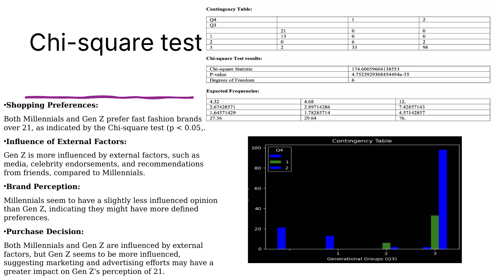
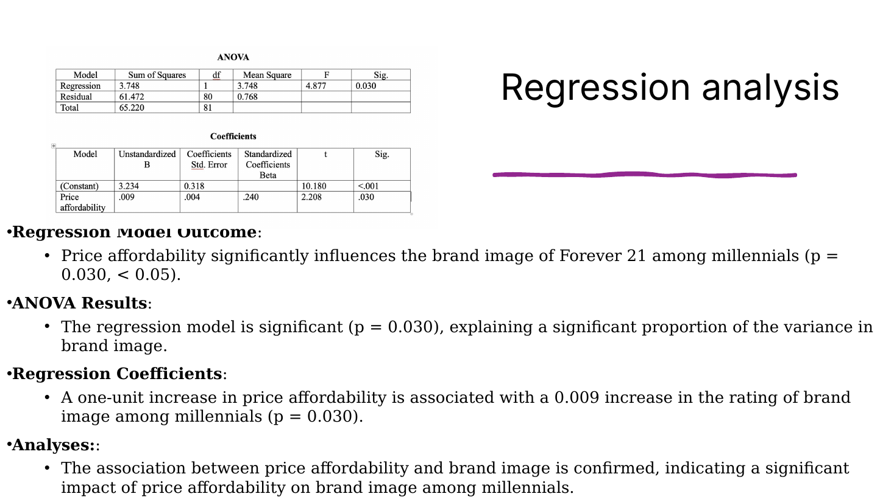

<div align="center">

# Millennials vs. Gen Z: Brand Perception & Purchasing Behavior

**A consumer research case study of Forever 21 in the fast-fashion industry**


</div>

---

## Research Objective

How do **Millennials and Gen Z perceive brands**, and how do those perceptions influence their purchasing decisions? This project uses Forever 21 as a case study.

## Research Questions

1. What do Millennials and Gen Z think about Forever 21's image and values compared with other fast-fashion brands?
2. How do outside influences (media, celebrities, friends) affect their perception of Forever 21 and their likelihood of shopping there?
3. What can Forever 21 do to improve its brand image and build loyalty and competitiveness?
4. How do the two generations interact with Forever 21 in physical stores versus online, and how does that shape their purchase decisions?
5. Are there generational differences in how they view brands and make purchases?

## Hypotheses

- **H1:** Customers who see Forever 21 as reflecting their values have more positive attitudes toward the brand.
- **H2:** Millennials lean toward in-store experiences, while Gen Z prefers online shopping.
- **H3:** Positive engagement with Forever 21 on social media improves brand perception and purchase intent.

## Methodology

- **Mixed-methods design:** A quantitative survey of Millennial and Gen Z consumers (138 responses) covering brand perception, purchasing habits, social media engagement, and demographics, plus qualitative interviews and focus groups.
- **Theoretical framework:** Brand Perception Theory, Social Identity Theory, Consumer Behavior Theory, and the Social Media Influence Framework.
- **Statistical tests:** T-tests, chi-square tests, ANOVA, linear regression, and logistic regression.

## Key Findings



| Analysis | Result |
|:--|:--|
| **T-test** | Significant difference in purchase intention between low-trust and high-trust groups (t = −3.646, p = 0.0006). **Trust drives purchasing.** |
| **Chi-square** | Both generations prefer other fast-fashion brands over Forever 21 (p < 0.05). Gen Z is more influenced by media, celebrities, and friends. |
| **Regression** | Price affordability significantly affects Forever 21's brand image among Millennials (p = 0.030). |
| **ANOVA** | Confirms the generational differences in external influence and brand preference. |
| **Logistic regression** | The model did not converge because of complete separation in the data, so its coefficients aren't interpretable. Regularization (lasso or ridge) is recommended. |





## Recommendations for Forever 21

- **Strengthen social media presence** with interactive content and influencer collaborations.
- **Improve sustainability practices** to attract eco-conscious customers.
- **Expand the online experience** with digital innovation.
- **Partner with influencers** who share the brand's values to build loyalty.
- **Use data analytics** to understand consumer preferences and tailor marketing.

## Repository Contents

```
forever21-genz-millennial-brand-perception/
├── README.md
├── images/           key statistical results
└── presentation/
    └── Forever21_Brand_Perception.pdf
```

## Context

Academic research project, Clark University, M.S. Business Analytics.
